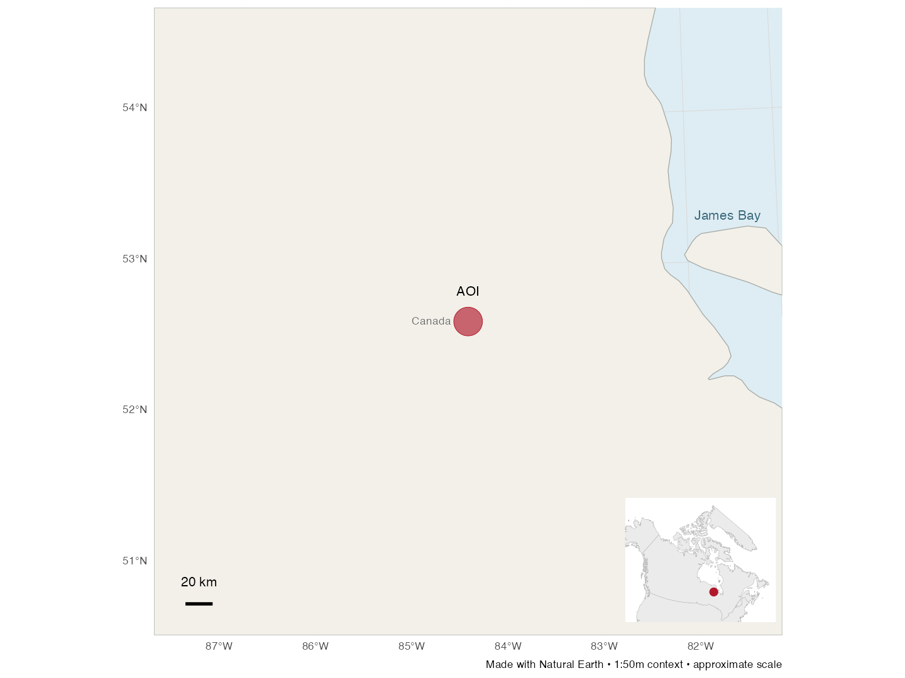
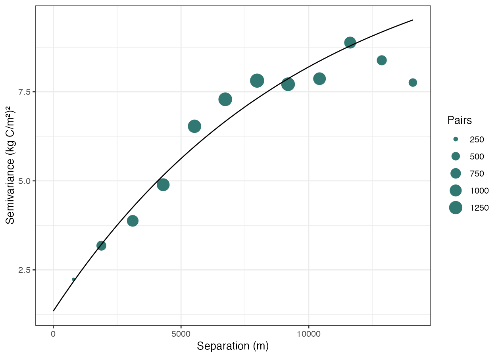
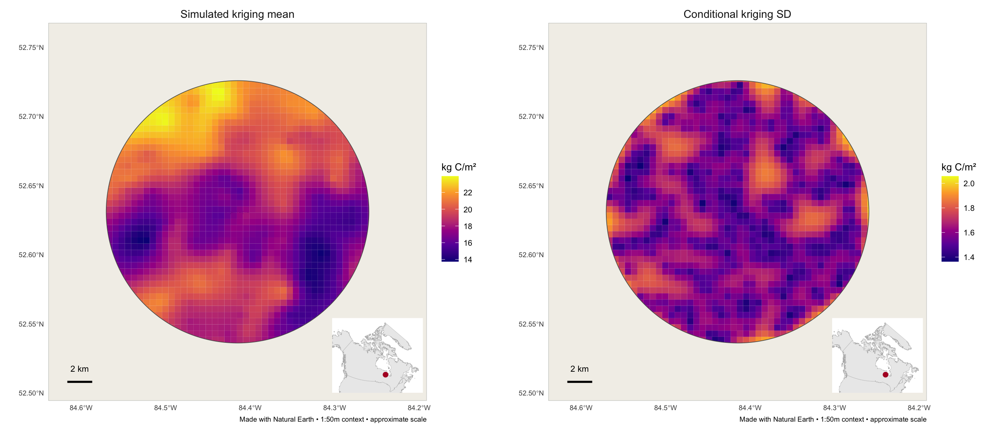

# Community Carbon Stock Analysis and Mapping

This workshop follows soil carbon data from field and laboratory measurements to comparisons, spatial estimates and an updated carbon map. It uses four illustrative cores within a 350 km² area in western James Bay. The field values, ecosystem areas, landscape predictors and prior map are teaching examples; their assumptions are identified at each stage.

By the end of the workshop, you will be able to calculate and compare soil carbon stocks, explain how different mapping methods use the data, and interpret the assumptions and uncertainty in a Bayesian update.

## Workshop overview

### Before you begin

Follow the [starter guide](start_here.md) to download the course and open `Community_Carbon_Analysis_and_Mapping.Rproj` in RStudio. Run code in the Console. `source()` runs the code in a saved R script.

To run the complete workshop and reproduce every figure:

```r
source("run_all.R")
```

This checks the required packages and runs the analysis in order. Alternatively, run `source("00_setup.R")` once, then use the code beneath each figure as you work through the sections. The script names, input files and output files are the same in both approaches. A figure opens when you run its `view_figure()` line; the analysis also saves the image for later use.

| Stage | Analysis | Main output | Next use |
| --- | --- | --- | --- |
| Part 1, Steps 1–2 | Check measurements; calculate slice and core stocks; summarise variation | `outputs/part1/` | Ground-data comparisons and spatial analysis |
| Part 1, Step 3 | Compare datasets, ecosystems, regions and studies | `outputs/part1/comparison/` | Interpret the community values in context |
| Part 2A | Apply group mean stocks to ecosystem areas | `outputs/part2/area/` | Supply the common area and grid for mapping |
| Part 2B | Estimate between cores using distance | `outputs/part2/spatial/` | Supply the new estimate for Part 3 |
| Part 2C | Fit and test a model using landscape information | `outputs/part2/spatial/` | Compare a separate modelling approach |
| Part 3 | Combine a prior map and a new estimate | `outputs/part3/` | Interpret the updated stock and uncertainty |

Each section identifies the **input**, **analysis**, **interpretation** and **application**. Read the figures alongside the saved tables and quality-control flags. Keep the same stock units and depth window when comparing methods. The [file-flow guide](data-flow.md) shows the dependencies in more detail.

The [explainer Google Doc](https://docs.google.com/document/d/1qflFw6CH69feNRr87Oi1SbHl0sY5bcXb-TuFI6KUtaU/edit) follows the same analysis sequence. Figure captions and the Fort Severn case-study text are left for the author to complete.

## Part 1 Field based analysis

### Step 1 Bring field and lab data

**Input:** [Workbook](../data/input/community_cores.xlsm): `3. Peat Data`, `2. Core Log`, and `1. Plot & Site Log`.

**Output:** Checked `core_input` in R, including quality-control (QC) flags. **Used next:** Step 2 recalculates stocks from the same workbook.

**Analysis:** Compile one row per sampled soil slice, with its core ID, upper and lower depths, dry bulk density and organic carbon concentration. Dry bulk density is the dry mass of soil per unit volume. Include the ecosystem and core coordinates. `readxl` imports the [example workbook](../data/input/community_cores.xlsm); macros are not needed.

**Interpretation:** Check IDs, units and depth coverage. Depth is measured downward from the ground surface, including the organic surface layer. The code below shows QC in memory; Step 2 saves [qc_flags.csv](../outputs/part1/qc_flags.csv). The confirmed J7 density correction, 0.9 → 0.09 g/cm³, is applied during import; the source workbook stays unchanged.

**Application:** Review each flag against the field and laboratory records before using the results. Keep the original workbook unchanged and document any accepted correction. Instructions for preparing your own table are in the [starter guide](start_here.md).

<details>
<summary>Copy R code</summary>

```r
source("config.R")
source("R/field.R")
core_input <- import_core_workbook(
  course_config$workbook_path,
  density_override_J7 = course_config$density_override_J7
)
core_input$qc
```

[Import and checking methods](../R/field.R)

</details>

### Step 2 Calculate stocks

**Input:** The [workbook](../data/input/community_cores.xlsm) checked in Step 1.

**Output:** [Core stocks](../outputs/part1/core_stocks.csv), [layer stocks](../outputs/part1/layer_stocks.csv), [statistics](../outputs/part1/descriptive_statistics.csv), [QC](../outputs/part1/qc_flags.csv), and the three figures below. **Used next:** Step 3 reads core/layer stocks; Part 2A reads core stocks and coordinates.


[Your figure caption]

<details>
<summary>Copy R code: make and view this figure</summary>

```r
# Re-read the workbook and rebuild Step 2 outputs.
source("scripts/01_field.R")
source("R/view.R")
view_figure("outputs/part1/common_depth_stock.png")
```

</details>

**Analysis:** Calculate the carbon stock in each slice, then add the slices within a defined depth window. Stock is the mass of carbon beneath a unit area of ground:

`Stock (kg C/m²) = 0.1 × bulk density (g/cm³) × organic C (%) × thickness (cm)`

Enter 45% as `45`, rather than `0.45`. For example, a 10 cm slice with a dry bulk density of 0.10 g/cm³ and 45% organic carbon contains `0.1 × 0.10 × 45 × 10 = 4.5 kg C/m²`. Multiply kg C/m² by 10 to convert to tonnes of carbon per hectare (t C/ha). Base R performs these calculations.

**Interpretation:** Compare the 0–30 cm window, which is complete for all four cores. The revised 0–30 cm stocks are 14.82 and 35.20 kg C/m² for the forest cores, and 10.44 and 12.70 for the wetland cores. Deeper sampled totals cover different depths. Forest 0–100 cm values remain missing.

**Application:** Compare equal depths. Missing soil below a core is not zero carbon.

[Stock calculations and figure code](../R/field.R)

### Step 2 continued Read carbon down the core

**Input:** The same [workbook](../data/input/community_cores.xlsm). Each block below reruns Step 2 and opens its named figure.

**Output:** [Layer stocks](../outputs/part1/layer_stocks.csv) and profile figures. **Used next:** Step 3 uses the layer table to match reference depths.


[Your figure caption]

<details>
<summary>Copy R code: make and view this figure</summary>

```r
# Re-read the workbook and rebuild Step 2 outputs.
source("scripts/01_field.R")
source("R/view.R")
view_figure("outputs/part1/depth_profiles.png")
```

</details>


[Your figure caption]

<details>
<summary>Copy R code: make and view this figure</summary>

```r
# Re-read the workbook and rebuild Step 2 outputs.
source("scripts/01_field.R")
source("R/view.R")
view_figure("outputs/part1/cumulative_stock.png")
```

</details>

**Analysis:** Plot carbon concentration, density and cumulative stock using `ggplot2`.

**Interpretation:** Each profile point represents a sampled slice, placed at its midpoint; lines connect the slices in depth order. Depth increases downward. Greater concentration alone does not guarantee greater stock: density and slice thickness matter too. The cumulative curve stops at sampled depth.

**Application:** Identify changes down the profile and choose a consistent reporting depth.

[Profile and cumulative-curve methods](../R/field.R)

### Step 3 Compare other ground data

**Input:** Step 2's [core stocks](../outputs/part1/core_stocks.csv) and [layer stocks](../outputs/part1/layer_stocks.csv), plus [reference summaries](../data/reference/).

**Output:** Comparison figures and [community-to-reference table](../outputs/part1/comparison/community_vs_reference_groups.csv). **Used next:** These comparisons provide context; Part 2A returns to Step 2's core stocks.

#### Comparison by collection


[Your figure caption]

<details>
<summary>Copy R code: make and view this figure</summary>

```r
# Requires core_stocks.csv and layer_stocks.csv from Step 2.
source("scripts/02_compare.R")
source("R/view.R")
view_figure("outputs/part1/comparison/stock_by_dataset.png")
```

</details>

#### Comparison by ecosystem


[Your figure caption]

<details>
<summary>Copy R code: make and view this figure</summary>

```r
# Requires core_stocks.csv and layer_stocks.csv from Step 2.
source("scripts/02_compare.R")
source("R/view.R")
view_figure("outputs/part1/comparison/stock_by_ecosystem.png")
```

</details>

**Analysis:** Compare the core results with precomputed summaries from five reference collections: NRCan peat, WoSIS, NPDB, Janousek and Riley. The figures group records by dataset, ecosystem, general region, study and source region. Stock figures use 0–30 cm; concentration and density figures use 0–5 cm. The code matches quantity, units, depth window and depth reference before comparing values. `R/compare.R` prepares the comparisons in base R and draws them with `ggplot2`.

**Interpretation:** Thick segments show the middle 50% of reference values, from the 25th to the 75th percentile. Dots show medians, diamonds show means, and dashed lines show the community cores. A median is the middle value after ordering the records; a mean is their arithmetic average. Some ecosystem and study labels are unavailable. Riley contributes concentration only.

**Application:** Identify which studies, ecosystems and regions provide the most relevant comparison. Ask whether a difference could reflect sampling depth, ecosystem, location or measurement method. These descriptive comparisons provide context; they do not establish the cause of a difference or validate an illustrative core.

[Comparison methods](../R/compare.R) · [Provenance and source limits](../SOURCES.md)

#### Comparison by general region


[Your figure caption]

<details>
<summary>Copy R code: make and view this figure</summary>

```r
# Requires core_stocks.csv and layer_stocks.csv from Step 2.
source("scripts/02_compare.R")
source("R/view.R")
view_figure("outputs/part1/comparison/stock_by_region.png")
```

</details>

#### Comparison by study


[Your figure caption]

<details>
<summary>Copy R code: make and view this figure</summary>

```r
# Requires core_stocks.csv and layer_stocks.csv from Step 2.
source("scripts/02_compare.R")
source("R/view.R")
view_figure("outputs/part1/comparison/stock_by_study.png")
```

</details>

#### Comparison by province or source region


[Your figure caption]

<details>
<summary>Copy R code: make and view this figure</summary>

```r
# Requires core_stocks.csv and layer_stocks.csv from Step 2.
source("scripts/02_compare.R")
source("R/view.R")
view_figure("outputs/part1/comparison/stock_by_source_region.png")
```

</details>

#### Carbon concentration comparison


[Your figure caption]

<details>
<summary>Copy R code: make and view this figure</summary>

```r
# Requires core_stocks.csv and layer_stocks.csv from Step 2.
source("scripts/02_compare.R")
source("R/view.R")
view_figure("outputs/part1/comparison/concentration_by_dataset.png")
```

</details>

#### Bulk density comparison


[Your figure caption]

<details>
<summary>Copy R code: make and view this figure</summary>

```r
# Requires core_stocks.csv and layer_stocks.csv from Step 2.
source("scripts/02_compare.R")
source("R/view.R")
view_figure("outputs/part1/comparison/density_by_dataset.png")
```

</details>

Study and source-region figures show the 20 largest groups by record count. Complete tables retain all groups, intervals and datums. Counts are profile records, not necessarily independent sites.

### Measurements and comparisons

Calculate these statistics for the same carbon pool and depth window:

| Statistic | What it describes | R calculation |
| --- | --- | --- |
| Number of cores, `n` | How many core values enter the summary | `length(x)` |
| Mean | Average stock | `mean(x)` |
| Sample standard deviation, SD | Spread of core stocks around their mean, in the stock units | `stats::sd(x)` |
| Coefficient of variation, CV (%) | Spread relative to the mean | `100 * stats::sd(x) / mean(x)` |

Here, `x` is a vector of complete 0–30 cm core stocks. For example, inspect the saved forest summary or reproduce it directly:

```r
cores <- read.csv("outputs/part1/core_stocks.csv")
x <- cores$stock_0_30_kg_m2[cores$group == "Forest cores"]
c(n = length(x), mean = mean(x), SD = stats::sd(x),
  CV_pct = 100 * stats::sd(x) / mean(x))
```

The two-core forest mean is 25.01 kg C/m² with SD 14.41 and CV 57.63%. The two-core wetland mean is 11.57 kg C/m² with SD 1.60 and CV 13.81%. These statistics describe the supplied cores. With only two cores in each group, they provide limited information about variation across the wider landscape. SD and CV are missing for ecosystems represented by only one core. [View all statistics](../outputs/part1/descriptive_statistics.csv).

### Data to retain

Keep core/sample IDs, ecosystem, slice boundaries, depth reference, density, carbon, units, measurement methods, coordinates/CRS and origin. Keep measured, estimated and illustrative values distinguishable. Retain QC flags alongside outputs.

## Part 2 Area based carbon stock analysis

### A Estimate totals by ecosystem

**Input:** Step 2's [core stocks and coordinates](../outputs/part1/core_stocks.csv), plus the [area boundary](../data/aoi/study_area.geojson). An area of interest (AOI) is the polygon that defines the study boundary. The example AOI is saved as `data/aoi/study_area.geojson`; its path is recorded in `config.R`.

**Output:** [Area totals](../outputs/part2/area/area_totals.csv), map figures, and [area checkpoint](../outputs/part2/area/area_analysis.rds). **Used next:** Part 2B reads that checkpoint, including the grid and four core stocks.



[Your figure caption]

```r
source("scripts/03_area.R")
source("R/view.R")
view_figure("outputs/part2/area/location_map.png")
```

The regional view uses cached land, lake, marine-area and settlement data. Main maps use a common extent, projected scale and Canada locator. This coarse context is for orientation; it does not define local ecosystems or exclude water from the analysis.


[Your figure caption]

<details>
<summary>Copy R code: make and view this figure</summary>

```r
# Requires Step 2 core_stocks.csv and data/aoi/study_area.geojson.
source("scripts/03_area.R")
source("R/view.R")
view_figure("outputs/part2/area/ecosystem_map.png")
```

</details>


[Your figure caption]

<details>
<summary>Copy R code: make and view this figure</summary>

```r
# Requires Step 2 core_stocks.csv and data/aoi/study_area.geojson.
source("scripts/03_area.R")
source("R/view.R")
view_figure("outputs/part2/area/group_stock_map.png")
```

</details>

**Analysis:** Divide the AOI into map cells and assign each cell the ecosystem of its nearest core. Apply the forest or wetland group mean 0–30 cm stock to the corresponding cells. Add stock multiplied by area to obtain a total:

`Total (tonnes C) = mean stock (kg C/m²) × area (m²) / 1,000`

**Interpretation:** `sf` clips cells to the boundary and calculates their areas; `terra` saves the raster maps. A raster is a map made of grid cells. The ecosystem zones are hypothetical land cover, so the resulting totals demonstrate the calculation rather than estimate a real inventory. Uniform colour within each forest or wetland group reflects the use of one mean stock.

**Application:** Compare the stock per unit area with the total stock: an ecosystem with a lower mean stock can still contain more carbon if it covers a larger area. For a real community inventory, use mapped ecosystem areas and sampling that represents their variation. [View totals](../outputs/part2/area/area_totals.csv).

[Area methods](../R/spatial.R)

### B Estimate between samples

**Input:** Part 2A's [area checkpoint](../outputs/part2/area/area_analysis.rds).

**Output:** The distance-weighted map and [spatial checkpoint](../outputs/part2/spatial/spatial_analysis.rds). This run also saves the separate simulation inspected in C. **Used next:** C inspects the simulation; Part 3 uses this distance-weighted map.


[Your figure caption]

<details>
<summary>Copy R code: make and view this figure</summary>

```r
# Requires Part 2A area_analysis.rds; also creates the C simulation.
source("scripts/04_spatial.R")
source("R/view.R")
view_figure("outputs/part2/spatial/idw_stock_map.png")
```

</details>

**Analysis:** Estimate the stock in each grid cell using inverse-distance weighting (IDW). This method gives nearer cores more influence: `wᵢ = 1 / distanceᵢ²`; `stock(s) = Σ(wᵢ × stockᵢ) / Σwᵢ`. Here, `distanceᵢ` is the distance from the cell to core `i`, `stockᵢ` is that core's stock, and `Σ` means add across cores. The power is 2. `gstat::idw()` calculates the weighted average in projected metres; `sf::st_distance()` supplies the separate distance diagnostic. `terra` saves the raster and `ggplot2` draws the map.

**Interpretation:** Smooth transitions show the weighting rule. Four cores do not establish spatial accuracy or a credible variogram. IDW and ordinary kriging are different methods; the following separate simulation restores the original overview’s kriging lesson.

**Application:** Compare this surface with the group mean map in A. Identify where distance weighting changes the pattern and where sparse sampling limits interpretation. Use those gaps to suggest additional sampling locations.

[Distance-weighting methods](../R/spatial.R)

#### Ordinary kriging with simulated observations

**Input:** The same AOI and grid in `area_analysis.rds`, plus 240 newly simulated observations from a stationary Gaussian spatial process. These are independent of the four workbook cores and separate from C’s regression simulation.

**Method and equation:** A variogram describes how differences between values change with distance: `gamma(h) = 0.5 × E[(Z(s+h) − Z(s))²]`. We use an exponential model: `gamma(h) = nugget + partial_sill × (1 − exp(−h/range))` for positive distance. The nugget represents variation at very short distances and measurement-scale noise; the partial sill describes spatially structured variation. Here the exponential range is a scale parameter; about three times that distance gives 95% of the structured sill.

Ordinary kriging estimates an unknown constant mean locally using `predicted stock = Σ(lambda_i × observed stock_i)`, with `Σlambda_i = 1`. The covariance model and locations determine the weights and conditional prediction variance. `gstat::variogram()`, `fit.variogram()` and `krige(stock_0_30_kg_m2 ~ 1, ...)` carry out the algorithms.



[Your figure caption]

```r
source("scripts/04b_kriging.R")
source("R/view.R")
view_figure("outputs/part2/kriging/variogram.png")
```



[Your figure caption]

```r
source("R/view.R")
view_figure("outputs/part2/kriging/kriging_maps.png")
read.csv("outputs/part2/kriging/metrics.csv")
```

**Assessment:** Hold out the eastern quarter, with a buffer of 5% of the sampled east–west span. Fit the variogram only on training data. Use five explicit candidate ranges, fit nonnegative nugget and partial sill, and choose the lowest training variogram fit error. Reject singular or unsupported fits. No held-out response chooses the range. Compare kriging with IDW on these same simulated training and test observations. Refit on all simulated observations only after assessment to make the demonstration map.

**Example output and interpretation:** With the fixed seed, 159 training and 60 held-out observations give RMSE about 3.63 for kriging and 2.87 kg C/m² for IDW. The nominal 95% conditional kriging intervals cover 80% of held-out values. This is a single simulated realisation, not evidence that either method is always better. A fitted covariance model can misrepresent uncertainty, especially away from training coverage. The variance also omits fitted-parameter uncertainty. Inspect lag-bin pair counts, fit and holdout results together.

**Next step:** Compare assumptions with C’s predictor model. These point predictions are not measured cell averages or block-kriging estimates. Do not add this separate simulation’s totals to the workbook inventory, use its variance as the four-core IDW uncertainty, or call it field-map validation. A real kriging analysis needs sufficient spatial sampling, trend and anisotropy checks, a defensible covariance model and assessment designed for its intended prediction task. [Maintained code](../R/kriging.R) · [Methods and sources](methods-audit.md).

### C Use landscape information

**Input:** The [spatial checkpoint](../outputs/part2/spatial/spatial_analysis.rds), figures and [holdout metrics](../outputs/part2/spatial/holdout_metrics.csv) already created in B.

**Output:** Inspect the saved model map and test results below. **Used next:** This is a separate simulation branch. Part 3 returns to B's distance-weighted map, rather than this regression map.


[Your figure caption]

<details>
<summary>Copy R code: inspect and view this figure</summary>

```r
# Inspect the checkpoint already created in B; do not rerun the model.
spatial_results <- readRDS("outputs/part2/spatial/spatial_analysis.rds")
stats::coef(spatial_results$final_model)
source("R/view.R")
view_figure("outputs/part2/spatial/model_stock_map.png")
```

</details>


[Your figure caption]

<details>
<summary>Copy R code: inspect and view this figure</summary>

```r
# Inspect the simulation test outputs already created in B.
read.csv("outputs/part2/spatial/holdout_metrics.csv")
source("R/view.R")
view_figure("outputs/part2/spatial/observed_predicted.png")
```

</details>

**Analysis:** Fit a linear regression using `stats::lm()`: `stock ~ wetness + elevation`. A regression estimates how stock changes with the predictor variables, here wetness and elevation. This separate exercise creates 160 simulated observations and simulated predictors. The model is fitted to 112 training observations; 48 eastern observations are held out for testing, meaning they do not enter that fit.

**Interpretation:** Points near the diagonal have smaller prediction errors. The held-out root mean square error, `RMSE = √mean((observed − predicted)²)`, is about 1.43 kg C/m²; lower values indicate smaller errors for the same quantity and units. The [metrics table](../outputs/part2/spatial/holdout_metrics.csv) also reports mean absolute error, `MAE = mean(abs(observed − predicted))`, and `R² = 1 − Σ(observed − predicted)² / Σ(observed − mean(observed))²`. Here, R² compares the predictions with using the mean held-out stock for every held-out observation. These scores assess the simulation; the extra observations do not represent field measurements. After testing, the model is fitted to all 160 simulated observations to make the final demonstration map.

**Application:** Compare the modelling assumptions with IDW: this method uses relationships with landscape variables rather than distance alone. With real data, use measured stocks and matching predictor maps, then assess predictions at locations excluded from fitting. The spatial separation of the test area checks performance away from the training locations.

[Simulation, regression and spatial-holdout methods](../R/spatial.R)

**Comparison checkpoint:** Read the totals from A, B and C over the same AOI and 0–30 cm depth:

```r
read.csv("outputs/part2/spatial/method_totals.csv")
```

The [method totals](../outputs/part2/spatial/method_totals.csv) are approximately 6.38 million tonnes C for group means, 6.40 million for IDW and 6.48 million for the simulated predictor model. Similar totals can conceal different spatial patterns. Identify which input data and assumptions changed between methods before interpreting their agreement.

Compare these maps with the prior before updating it. `prior_comparison.csv` uses the same invented prior as Part 3, on the same grid, depth and units. Differences from an invented prior cannot measure accuracy. For a real prior, first reconcile footprint, mask, depth datum and point-versus-cell support; do not compare misaligned raster pixels.

```r
read.csv("outputs/part2/spatial/prior_comparison.csv")
```

## Part 3 Bayesian updating of prior maps

**Input:** Part 2B's distance-weighted values in the [spatial checkpoint](../outputs/part2/spatial/spatial_analysis.rds), plus an invented prior and assumed uncertainties.

**Output:** Updated maps, [summary](../outputs/part3/bayesian_summary.csv), and [cell values](../outputs/part3/bayesian_grid.csv). **Used next:** Inspect the change and uncertainty before replacing illustrative inputs.


[Your figure caption]

<details>
<summary>Copy R code: make and view this figure</summary>

```r
# Requires Part 2B spatial_analysis.rds; updates its IDW map.
source("scripts/05_bayes.R")
source("R/view.R")
view_figure("outputs/part3/bayesian_maps.png")
```

</details>


[Your figure caption]

<details>
<summary>Copy R code: make and view this figure</summary>

```r
# Requires Part 2B spatial_analysis.rds; updates its IDW map.
source("scripts/05_bayes.R")
source("R/view.R")
view_figure("outputs/part3/uncertainty.png")
```

</details>

**Analysis:** Use Bayesian updating to combine a prior estimate (the map available before the new analysis) with a new estimate (the IDW map from Part 2B). The result is the posterior, or updated estimate. This normal–normal model gives greater weight to the estimate with lower variance. Base R implements the update:

`Vpost = 1 / (1/Vprior + 1/Vnew)`

`Meanpost = Vpost × (Meanprior/Vprior + Meannew/Vnew)`

**Interpretation:** `V` means variance, or SD². “Prior”, “new” and “post” identify the two input estimates and the posterior. Prior SD = 5 and new-estimate SD = 3 kg C/m² are assumptions; the updated SD is about 2.57. Because the new estimate has lower assumed variance, the updated map is closer to it. Compare the prior, updated and change panels to locate the largest adjustments; use the uncertainty figure to examine the effect of the assumed SDs.

**Application:** Before updating a real map, match carbon pool, depth, units and spatial coverage, and justify the uncertainties assigned to both estimates. This formula assumes independent errors. Variation among cores is not automatically uncertainty in a map estimate, and uncertainty for individual cells does not directly give uncertainty for a whole-area total.

[Bayesian formula and assumptions](../R/spatial.R)

**Comparison checkpoint:** Inspect how the mean stock, area total and assumed cell uncertainty change from the prior to the updated estimate:

```r
read.csv("outputs/part3/bayesian_summary.csv")
```

The updated total is about 5.82 million tonnes C, between the prior total of 4.19 million and the new IDW estimate of 6.40 million. Explain why the updated result is closer to IDW using the assumed uncertainties. These totals demonstrate the updating calculation; the stated cell uncertainties are not uncertainty bounds on the totals.

## 4 Case studies

### Fort Severn

[Your case-study text, figures and interpretation]

The real Fort Severn analysis has not been rerun in this illustrative course. Retain the original case-study plan: report and poster; Li et al. 2025 Hudson and James Bay lowland prior; Riley, NRCan peat, WoSIS, NPDB and PEATGRIDS context; peat-depth and mineral-soil questions. The original Li citation and map specification still need confirmation before an import is possible. Match depth, carbon pool, units and support before comparing or updating any such product. Chronology, accumulation rates and accumulation-through-time curves remain deferred; the depth-based cumulative stock curve above is retained.

## Code and detailed methods

`readxl` imports the workbook; base R/`stats` calculate stocks, summaries, regression and updating; `gstat` supplies IDW and ordinary kriging; `sf` handles geometry and distance; `terra` writes rasters; `ggplot2` draws figures.

Run steps in order, or use `source("run_all.R")`. The [input/output guide](data-flow.md) shows each dependency. If you change the workbook, rerun Step 2 and the later steps; opening an existing image alone does not refresh it. [Field methods](../R/field.R), [comparison methods](../R/compare.R) and [spatial/Bayesian methods](../R/spatial.R) contain the full functions. Each spatial output folder includes `method_metadata.csv` with its formula, packages and assumptions.

The course rebuilds community comparisons and figures from [precomputed reference summaries](../SOURCES.md); it does not rebuild those summaries from raw reference profiles. Keep the original data, configuration and QC outputs with your results.

## Adapt the workshop to your own area

Use the [starter guide](start_here.md) for the exact field-sheet columns, coordinate format and AOI file instructions. Save your measurements as `data/input/my_field_data.csv` and your polygon as `data/aoi/my_aoi.geojson`, then run `source("run_my_data.R")`. This provides a convenient starting exercise for your own stocks, profiles and IDW map in `outputs/my_data/`; it does not replace the complete workshop above. Use matching measurements and coordinates for the new AOI. At least two distinct locations inside the boundary must have complete 0–30 cm stock values for this IDW exercise.

To transfer the later analyses to a real area, prepare the corresponding inputs: mapped ecosystems and representative stock values for area totals; observed stocks and matching predictor maps for regression and testing; and a prior map with justified uncertainties for Bayesian updating. Use `source("run_local_workshop.R")` for the configurable local-data interfaces described in [local inputs](local-inputs.md). Unconfigured later stages are reported as not run. The complete `run_all.R` retains the teaching simulations. Changing only the AOI does not supply those data or convert the demonstration into a real carbon inventory.
