# Community Carbon Stock Analysis and Mapping

This workshop shows what we analyse, how to read the results, and how to use them. It follows the [explainer Google Doc](https://docs.google.com/document/d/1qflFw6CH69feNRr87Oi1SbHl0sY5bcXb-TuFI6KUtaU/edit).

Run the example first, inspect its outputs, then substitute your data. Start with the [download and setup instructions](../README.md#download-and-run-in-r).

The revised workbook is illustrative. The 350 km² western James Bay area, core locations and ecosystem assignments are conceptual. Later landscape and Bayesian examples use additional simulated inputs, clearly separated from the four cores.

## Part 1 Field based analysis

### Step 1 Bring field and lab data

**Analyse:** Bring each core's depth intervals, dry bulk density and organic carbon into [one workbook](../data/input/community_cores.xlsm). `readxl` reads the inputs; macros are not needed.

**Read:** Check IDs, units and depth coverage. R records issues in [qc_flags.csv](../outputs/part1/qc_flags.csv). The confirmed J7 density correction, 0.9 → 0.09 g/cm³, is applied during import; the source workbook stays unchanged.

**Apply:** Correct data-entry issues before using the results. For another workbook, change `config.R` and disable the example-only correction.

<details>
<summary>Copy R code</summary>

```r
source("config.R")
source("R/field.R")
core_input <- import_core_workbook(
  course_config$workbook_path,
  density_override_J7 = course_config$density_override_J7
)
core_input$qc
```

[Import and checking methods](../R/field.R)

</details>

### Step 2 Calculate stocks

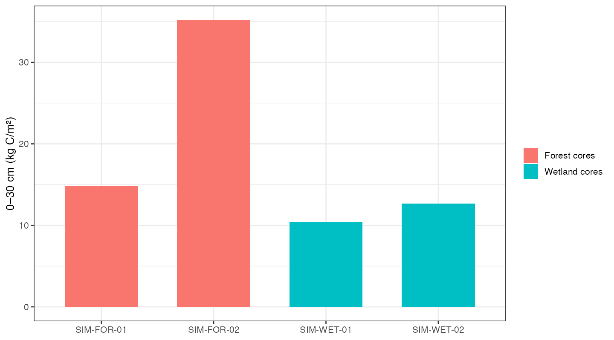

[Your figure caption]

**Analyse:** Calculate carbon in each slice, then add slices over a shared depth:

`Stock (kg C/m²) = 0.1 × bulk density (g/cm³) × organic C (%) × thickness (cm)`

Enter 45% as `45`. Multiply kg C/m² by 10 for t C/ha.

**Read:** The revised 0–30 cm stocks are 14.82 and 35.20 kg C/m² for the forest cores, and 10.44 and 12.70 for the wetland cores. Deeper sampled totals cover different depths. Forest 0–100 cm values remain missing.

**Apply:** Compare equal depths. Missing soil below a core is not zero carbon.

<details>
<summary>Copy R code</summary>

```r
source("config.R")
source("R/field.R")
core_input <- import_core_workbook(course_config$workbook_path,
  density_override_J7 = course_config$density_override_J7)
field_results <- analyse_core_data(core_input,
  out = "outputs/part1", data_origin = course_config$data_origin)
field_results$cores
```

[Stock calculations and figure code](../R/field.R)

</details>

### Step 2 continued Read carbon down the core

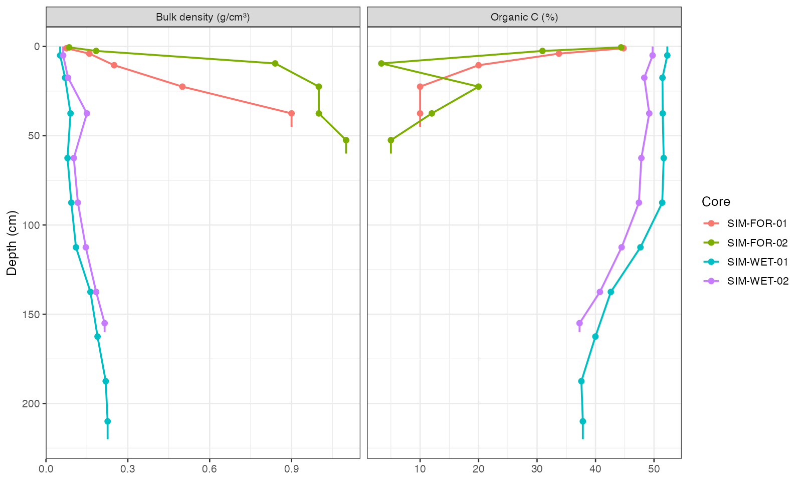

[Your figure caption]

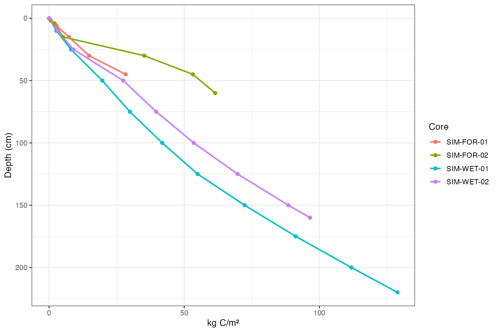

[Your figure caption]

**Analyse:** Plot carbon concentration, density and cumulative stock using `ggplot2`.

**Read:** Each profile point represents a sampled slice; depth increases downward. Greater concentration alone does not guarantee greater stock: density and slice thickness matter too. The cumulative curve stops at sampled depth.

**Apply:** Identify changes down the profile and choose a consistent reporting depth.

<details>
<summary>Copy R code</summary>

```r
source("scripts/01_field.R")
read.csv("outputs/part1/layer_stocks.csv")
```

[Profile and cumulative-curve methods](../R/field.R)

</details>

### Step 3 Compare other ground data

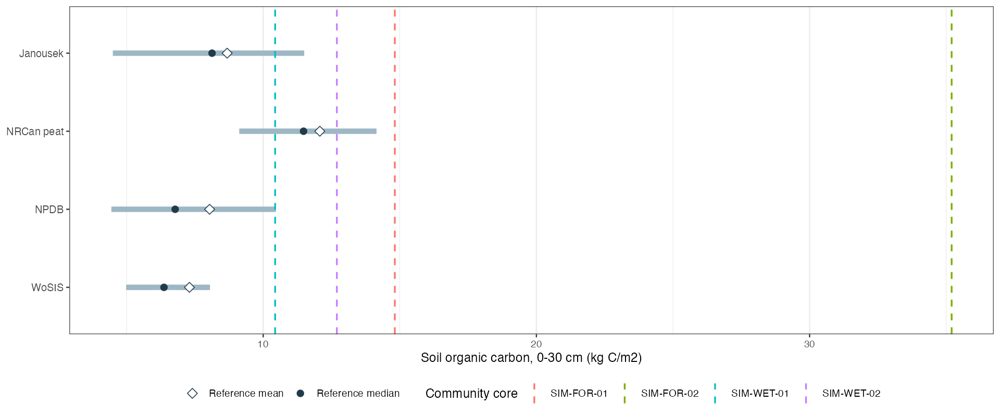

[Your figure caption]

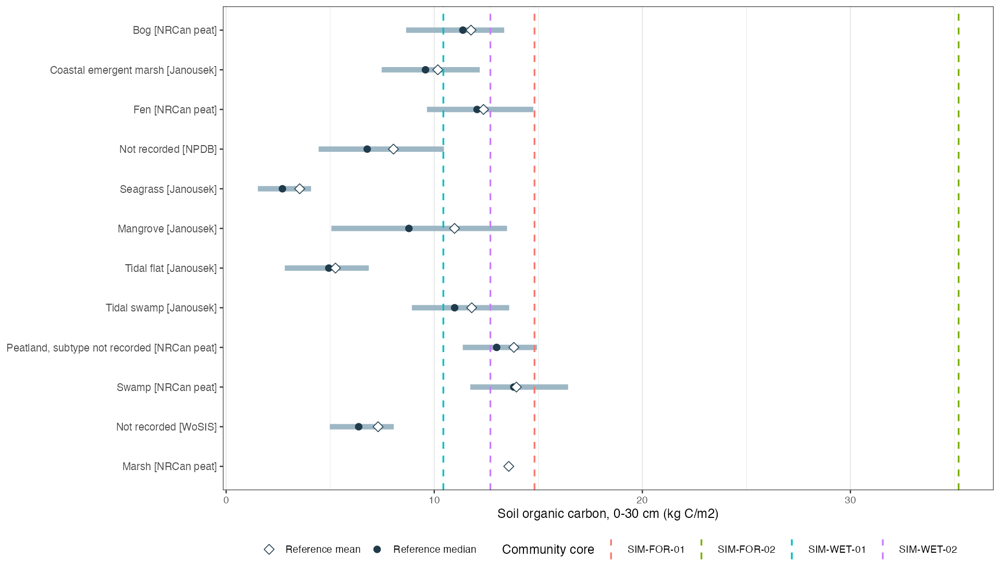

[Your figure caption]

**Analyse:** Compare with precomputed summaries from NRCan peat, WoSIS, NPDB, Janousek and Riley. Match quantity, units, depth and depth reference.

**Read:** Thick segments show the middle half of reference values; dots show medians, diamonds show means, and dashed lines show your cores. Some ecosystem and study labels are unavailable. Riley contributes concentration only.

**Apply:** Put your results in context and choose relevant reference groups. These descriptive comparisons do not establish why groups differ or validate an illustrative core.

<details>
<summary>Copy R code</summary>

```r
source("config.R")
source("R/compare.R")
comparison_results <- run_reference_comparison(course_config)
comparison_results$availability
```

[Comparison methods](../R/compare.R) · [Provenance and source limits](../SOURCES.md)

</details>

<details>
<summary>More comparison figures</summary>

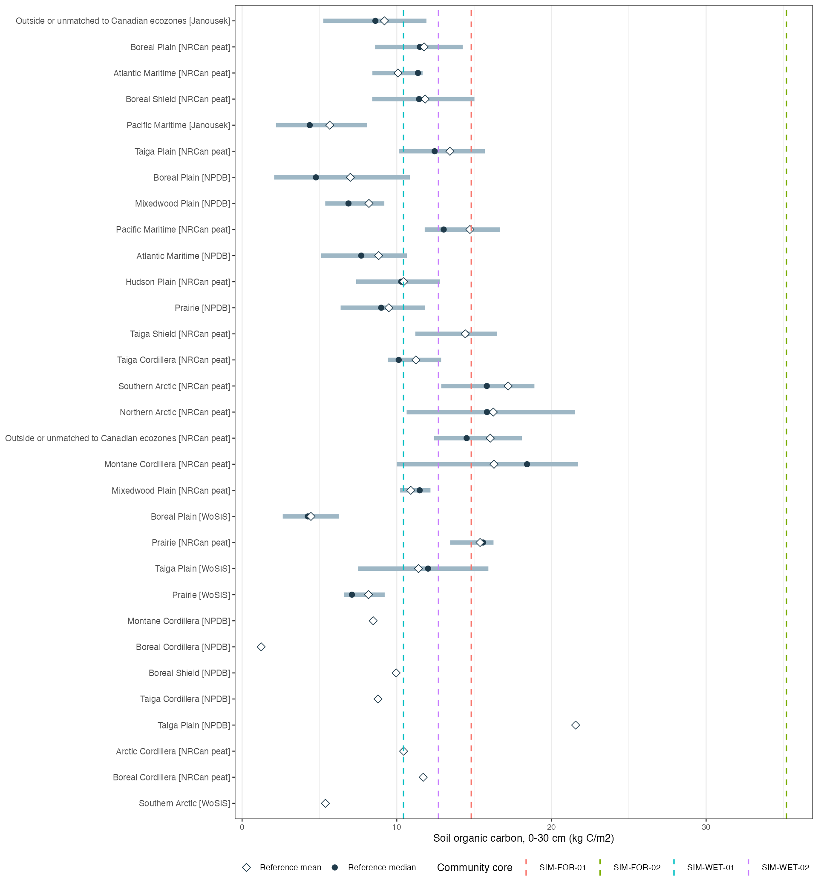

[Your figure caption]

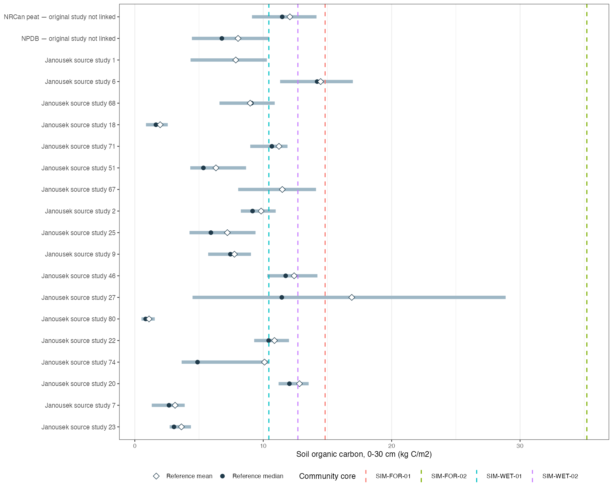

[Your figure caption]

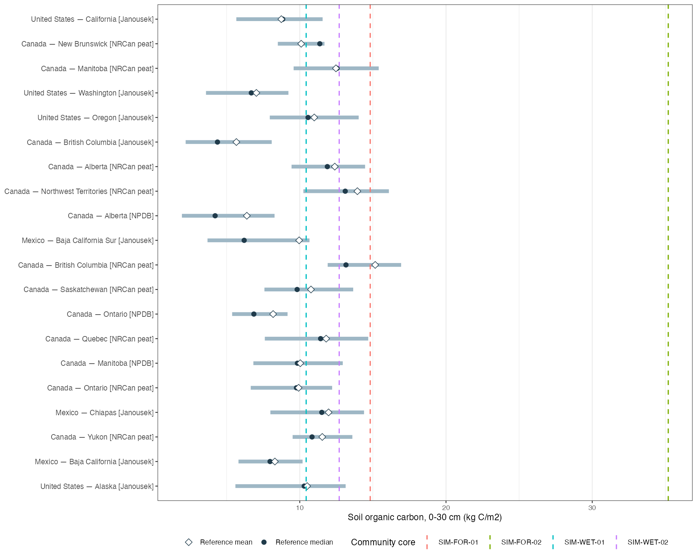

[Your figure caption]

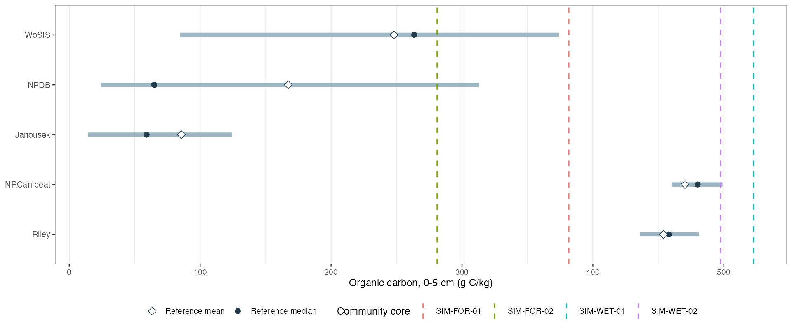

[Your figure caption]

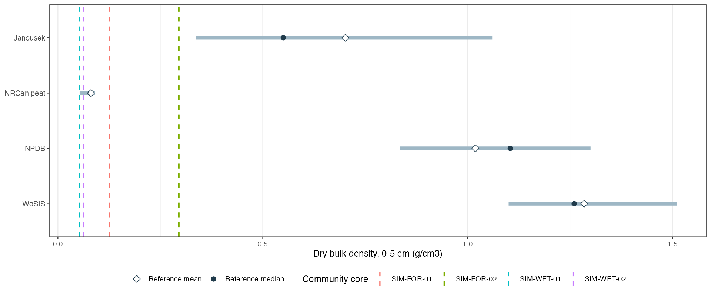

[Your figure caption]

Study and source-region figures show the 20 largest groups by record count. Complete tables retain all groups, intervals and datums. Counts are profile records, not necessarily independent sites.

</details>

### Measurements and comparisons

Use the mean to summarise cores, sample SD to describe their spread, and `CV (%) = 100 × SD / mean` to express relative spread. R uses `mean()` and `stats::sd()`.

The two-core forest mean is 25.01 kg C/m²; the two-core wetland mean is 11.57. These describe this example, not the wider landscape. [View statistics](../outputs/part1/descriptive_statistics.csv).

### Data to retain

Keep core/sample IDs, ecosystem, slice boundaries, depth reference, density, carbon, units, measurement methods, coordinates/CRS and origin. Keep measured, estimated and illustrative values distinguishable. Retain QC flags alongside outputs.

## Part 2 Area based carbon stock analysis

### A Estimate totals by ecosystem

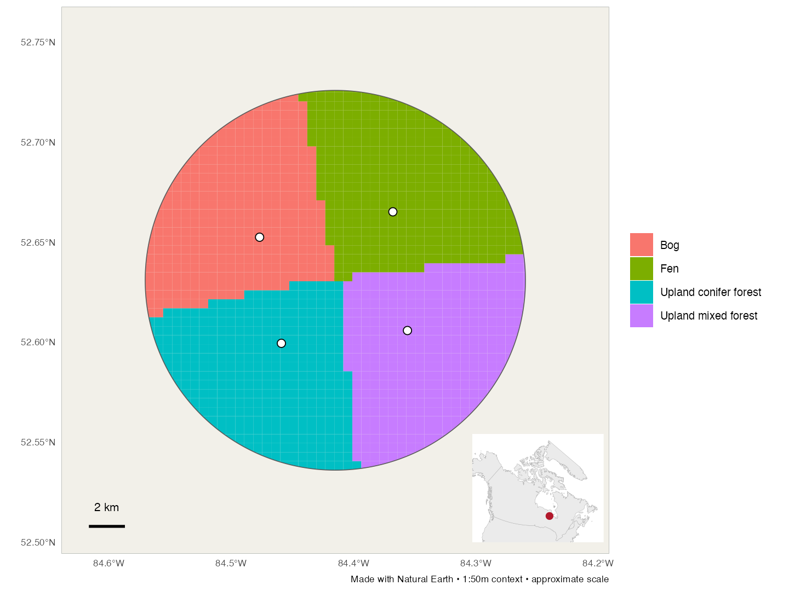

[Your figure caption]

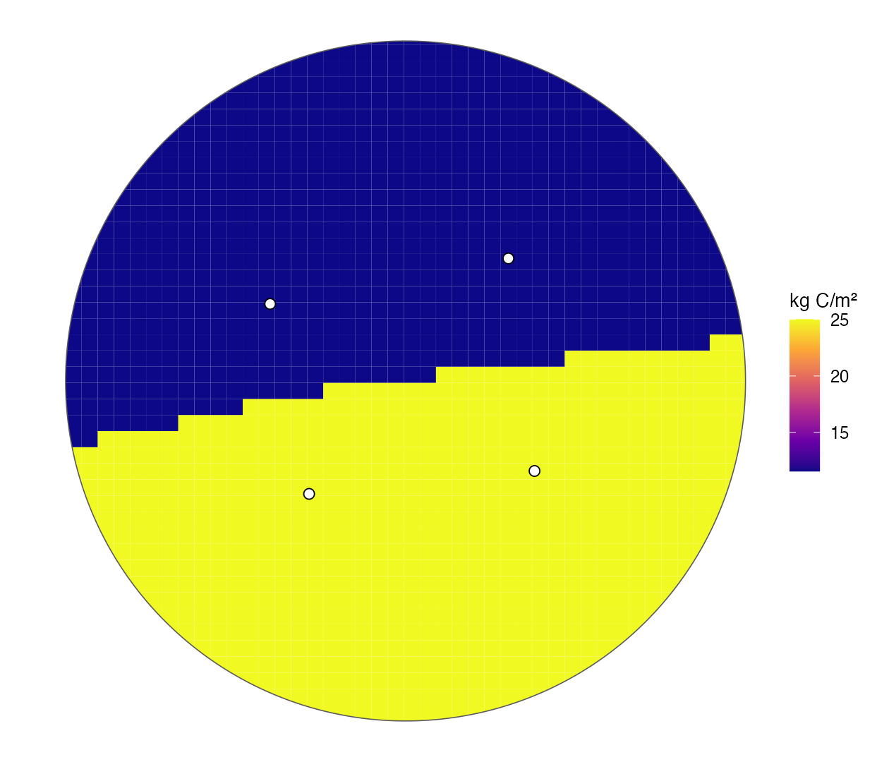

[Your figure caption]

**Analyse:** Apply each group's mean 0–30 cm stock to its area:

`Total (tonnes C) = mean stock (kg C/m²) × area (m²) / 1,000`

**Read:** `sf` calculates clipped cell areas; `terra` writes map grids. The example assigns ecosystem zones by the nearest core. They are hypothetical land cover.

**Apply:** Replace these zones with mapped ecosystems and representative sampling before estimating a real community inventory. [View totals](../outputs/part2/area/area_totals.csv).

<details>
<summary>Copy R code</summary>

```r
source("config.R")
source("R/spatial.R")
area_results <- run_area_analysis(course_config)
area_results$area_totals
```

[Area methods](../R/spatial.R)

</details>

### B Estimate between samples

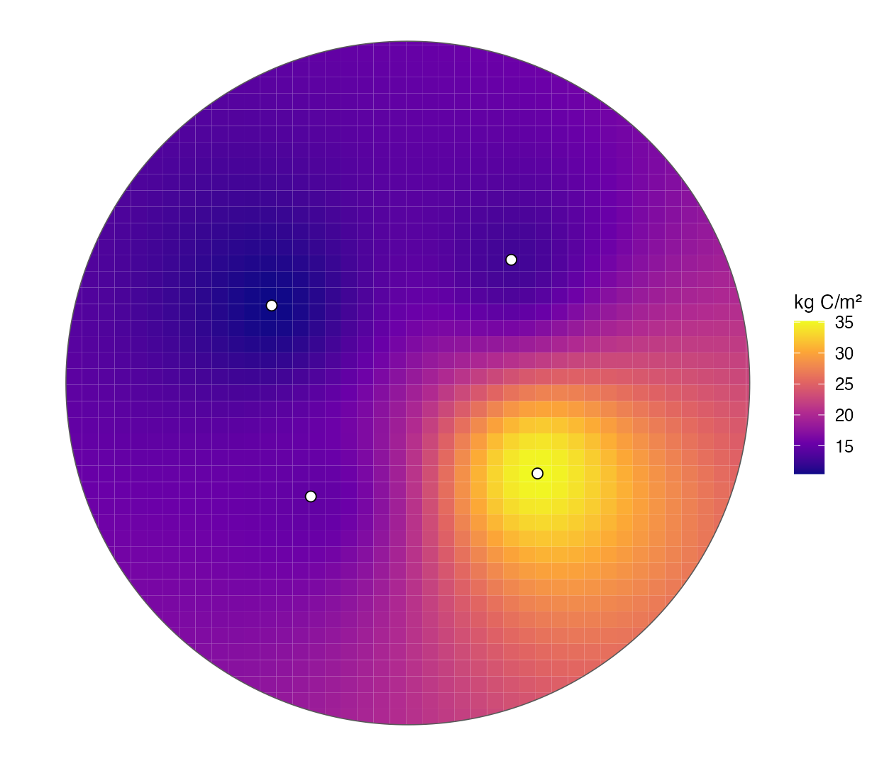

[Your figure caption]

**Analyse:** Give nearer cores more influence using inverse-distance weighting: `wᵢ = 1 / distanceᵢ²`; `stock(s) = Σ(wᵢ × stockᵢ) / Σwᵢ`. Base R calculates the weighted average; `sf::st_distance()` supplies distances.

**Read:** Smooth transitions show the weighting rule. Four cores do not establish spatial accuracy; this step does not fit kriging or a variogram.

**Apply:** Explore how sample placement affects the picture and where more measurements could help.

<details>
<summary>Copy R code</summary>

```r
source("config.R")
source("R/spatial.R")
spatial_results <- run_spatial_analysis(course_config, seed = course_config$seed)
spatial_results$totals
```

[Distance-weighting methods](../R/spatial.R)

</details>

### C Use landscape information

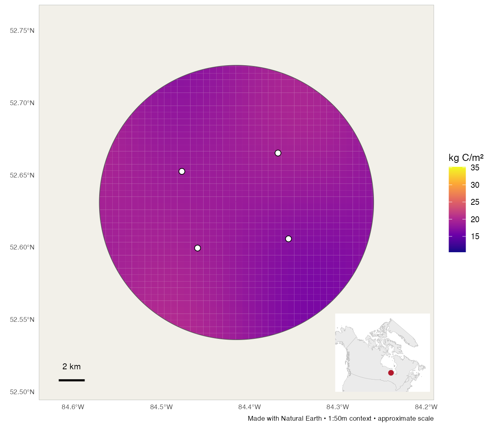

[Your figure caption]

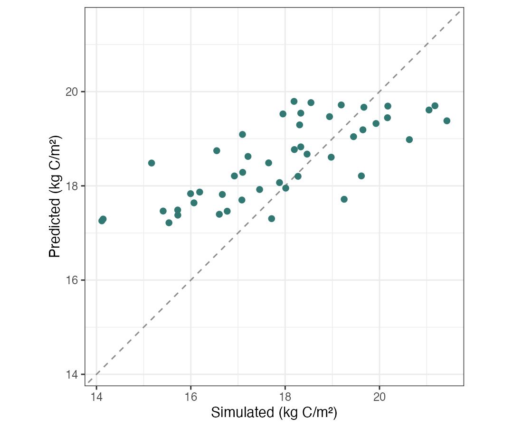

[Your figure caption]

**Analyse:** Fit `stock ~ wetness + elevation` with `stats::lm()`. This separate exercise creates 160 simulated observations and simulated predictors: 112 train the model and 48 eastern observations test it.

**Read:** Points near the diagonal have smaller prediction errors. `RMSE = √mean((observed − predicted)²)` summarises error size. These are simulation results, not extra field observations or validation of real carbon stocks. The final demonstration map is refitted after testing.

**Apply:** With real data, select useful predictors and test predictions at locations excluded from fitting.

<details>
<summary>Copy R code</summary>

```r
source("config.R")
source("R/spatial.R")
spatial_results <- run_spatial_analysis(course_config, seed = course_config$seed)
spatial_results$metrics
```

[Simulation, regression and spatial-holdout methods](../R/spatial.R)

</details>

## Part 3 Bayesian updating of prior maps

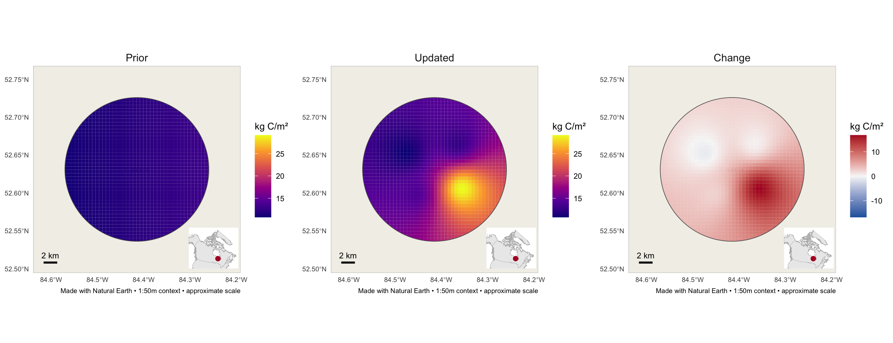

[Your figure caption]

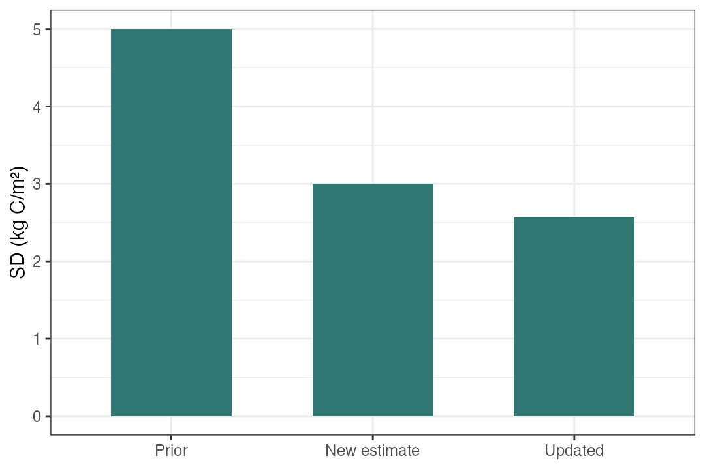

[Your figure caption]

**Analyse:** Combine a prior estimate and a new estimate, giving more weight to the estimate with less uncertainty. Base R implements the normal–normal update:

`Vpost = (1/Vprior + 1/Vnew)^−1`

`Meanpost = Vpost × (Meanprior/Vprior + Meannew/Vnew)`

**Read:** `V` means variance, or SD². The example combines an invented prior map with the distance-weighted map. Prior SD = 5 and new-estimate SD = 3 kg C/m² are assumptions; updated SD is about 2.57.

**Apply:** Match quantities and use justified uncertainties before updating a real map. The formula assumes independent errors. Core-to-core SD is not automatically map uncertainty, and cell uncertainty does not give uncertainty for the whole-area total.

<details>
<summary>Copy R code</summary>

```r
source("config.R")
source("R/spatial.R")
bayesian_results <- run_bayesian_update(course_config)
bayesian_results$summary
```

[Bayesian formula and assumptions](../R/spatial.R)

</details>

## 4 Case studies

### Fort Severn

[Your case-study text, figures and interpretation]

The real Fort Severn analysis has not been rerun in this illustrative course.

## Code and detailed methods

`readxl` imports the workbook; base R/`stats` calculate stocks, summaries, regression and updating; `sf` handles geometry and distance; `terra` writes rasters; `ggplot2` draws figures.

Run steps in order, or use `source("run_all.R")`. [Field methods](../R/field.R), [comparison methods](../R/compare.R) and [spatial/Bayesian methods](../R/spatial.R) contain the full functions. Each spatial output folder includes `method_metadata.csv` with its formula, packages and assumptions.

The course rebuilds community comparisons and figures from [precomputed reference summaries](../SOURCES.md); it does not rebuild those summaries from raw reference profiles. Keep the original data, configuration and QC outputs with your results.
