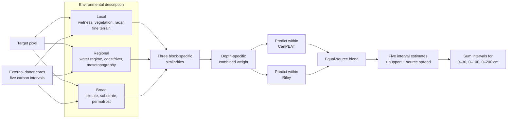

# Hierarchical multi-scale similarity micro-pilot

## Purpose and boundary

This is a small, research-only test of one question:

> Can a soil core be transferred more reliably when similarity is calculated separately for local, regional, and broad environmental processes, with the balance between scales allowed to change by soil depth?

The first run uses a roughly 2 km by 2 km, Route L-aligned 30 m carrier grid (about 4,500 cells), Riley and CanPEAT donor cores, and five fixed depth intervals. It writes only to `outputs/covariate_analysis/part16_hierarchical_similarity_micro_pilot/`. It does not alter or replace any authoritative Route L product.

Thirty metres is the export grid, not a claim of 30 m predictive accuracy.

## Analysis in one picture



The separation of scales is the main experiment. A donor can be climatically suitable but locally unlike the target; the model retains that distinction rather than hiding it in one flat distance.

## Covariate stack for the first test

| Block | Process represented | Default pilot bands | High-value additions after the pilot |
|---|---|---|---|
| Local | Microsite moisture, vegetation and microtopography | Sentinel-2 NDVI/EVI/NDMI medians and variability; Dynamic World tree/shrub/flooded/water probabilities; Sentinel-1 VV/VH/contrast metrics; slope and 120 m relative elevation | field wetland class; very-high-resolution microtopography; seasonal inundation duration |
| Regional | Landscape position and hydrologic connectivity | JRC water occurrence, seasonality and recurrence; distance to observed water; 1 km elevation context | authoritative river/channel distance; coastline distance; floodplain/tidal connectivity; depositional landform |
| Broad | Long-term controls on carbon accumulation | ERA5-Land mean temperature, temperature variability, precipitation and freezing months | surficial geology/parent material; permafrost/ground ice; snow/freeze-thaw and growing-season metrics |
| QA | Whether a value is trustworthy | observation counts for Sentinel-2, Dynamic World and Sentinel-1 | sensor-specific completeness and temporal representativeness flags |

Raw TWI is excluded because the existing low-relief AOI test found it unstable. Li/Sothe carbon surfaces remain comparison or prior products, not ordinary predictors. Categorical geology or permafrost codes must be one-hot encoded or compared by exact match; numeric differences between class IDs have no meaning.

## Step-by-step analysis

### 1. Fix the targets

Each core is represented by five non-overlapping carbon-stock responses:

1. 0–15 cm
2. 15–30 cm
3. 30–50 cm
4. 50–100 cm
5. 100–200 cm

Only donors with a complete measured interval are eligible for that interval. A core can therefore contribute to one depth and be excluded from another.

### 2. Export exactly the same predictors for donors and map cells

The small-area raster and external donor table must use identical band names, dates, reducers, units, grids, and missing-value rules. Carbon responses stay local and are joined after export by `core_uid`; they are not sent through Earth Engine.

The micro-pilot exporter creates the tiny raster. A separate sharded exporter samples the same predictors at external cores across Canada. The first test deliberately restricts the donor pool to Riley and CanPEAT so that the computation and source effects remain inspectable.

### 3. Clean and robustly standardize

For covariate $j$, using donor values only:

\[
z_{ij}=\frac{x_{ij}-\operatorname{median}(x_{\cdot j})}
{\operatorname{MAD}(x_{\cdot j})}
\]

If MAD is zero, use the donor standard deviation; if both are zero, drop the variable. The exported `-9999` sentinel is converted to missing before any calculation. The same donor-derived transformation is then applied to target pixels.

### 4. Calculate one similarity per scale

For target pixel $p$, donor $i$, scale block $s$, and the set of jointly observed covariates $J_{pis}$:

\[
S_{pis}=\exp\left[-\frac{1}{2|J_{pis}|}
\sum_{j\in J_{pis}}
\left(\frac{z_{pj}-z_{ij}}{h_s}\right)^2\right]
\]

This produces three transparent scores between 0 and 1: local, regional, and broad. The starting bandwidth is $h_s=1$ robust standard deviation. Bandwidths must be changed only through held-out validation.

### 5. Let scale importance change with depth

For interval $d$, combine the three block scores with a product of experts:

\[
K_{pid}=I_{id}\prod_{s\in\{L,R,B\}}S_{pis}^{\alpha_{ds}}
\]

Here $I_{id}=1$ only when donor $i$ has a complete carbon measurement for interval $d$. A poor match at one important scale therefore reduces the final donor weight rather than being completely cancelled by another scale.

The following are starting hypotheses, not fitted truths:

| Depth | Local \(\alpha_L\) | Regional \(\alpha_R\) | Broad \(\alpha_B\) |
|---|---:|---:|---:|
| 0–15 cm | 0.50 | 0.30 | 0.20 |
| 15–30 cm | 0.40 | 0.35 | 0.25 |
| 30–50 cm | 0.30 | 0.40 | 0.30 |
| 50–100 cm | 0.20 | 0.40 | 0.40 |
| 100–200 cm | 0.10 | 0.35 | 0.55 |

The editable copy is `config/hierarchical_similarity_depth_exponents.csv`. The intended pattern is local dominance near the surface and increasing broad-scale control with depth. The locked study/spatial folds decide whether that idea is supported.

### 6. Predict within each source first

For source $g$, such as CanPEAT or Riley:

\[
\widehat C^{(g)}_{pd}=
\frac{\sum_{i\in g}K_{pid}C_{id}}
{\sum_{i\in g}K_{pid}}
\]

Then pool the available source-specific estimates equally:

\[
\widehat C_{pd}=\frac{1}{G_{pd}}
\sum_{g=1}^{G_{pd}}\widehat C^{(g)}_{pd}
\]

This prevents the largest database from winning simply because it contains more rows. Source-specific estimates and their spread are retained; they are never hidden behind the pooled value.

### 7. Quantify support, not just the estimate

For every pixel and depth, report:

\[
N_{\mathrm{eff}}=
\frac{(\sum_i K_{pid})^2}{\sum_i K_{pid}^2}
\]

along with maximum combined similarity, the number of eligible donors, covariate overlap by block, weighted donor spread, between-source spread, and the highest-weight donors. Low support becomes a mask or warning, not a confident-looking carbon number.

### 8. Reconstruct cumulative stocks

Because the depth intervals do not overlap:

\[
\widehat C_{0:200}=\widehat C_{0:15}+\widehat C_{15:30}+
\widehat C_{30:50}+\widehat C_{50:100}+\widehat C_{100:200}
\]

The same summation gives 0–30 and 0–100 cm stocks. Interval-level values remain the primary outputs so that a deep-data weakness is not concealed inside a total.

### 9. Validate before interpreting the map

Use the existing locked external study/spatial folds to compare the hierarchical model against at least three baselines: source mean, the existing flat environmental similarity, and the strongest existing external vertical-profile model. Also run leave-one-community-core-out checks for 0–15 and 15–30 cm.

Adopt the idea only if it improves held-out error, remains stable across sources, and has defensible support/calibration. The community cores do not validate the three intervals below 30 cm; those outputs must remain labelled **external-reference predictions**.

## Output contract

The pilot should produce, at minimum:

- one row per target and depth with pooled and source-specific predictions;
- local, regional, broad, and combined similarities;
- effective donor count, donor spread, source spread, and missingness diagnostics;
- a ranked donor table showing why each prediction was made;
- five interval layers, cumulative 0–30/0–100/0–200 layers, and support layers for the tiny raster;
- an input-shard manifest, scaling table, depth-weight table and run notes. Before any adoption decision, extend this to full input hashes and software/spatial-library versions.

## In-GEE logic smoke test

Before interpreting the downloaded TIFF, run `scripts/gee/hierarchical_similarity_gee_smoke_test.js` after the complete micro-pilot exporter in the same Earth Engine script. If the TIFF task has already been submitted, leave it running and change the parent script back to `START_EXPORTS = false` before rerunning; the smoke test itself creates no exports.

With its defaults, the add-on places one held-out synthetic target and 25 seeded pseudo-donors on covariate-supported pixels inside `pilotArea`. It samples representative local, regional and broad bands, derives scaling from donors only, calculates the three Gaussian similarities, applies all five depth-specific product-of-experts weight sets, and prints synthetic truth versus prediction. It also prints zero-variance blocks, effective donor counts and top donors. This is a deterministic plumbing check, not ecological validation.

To use a real Fort Severn location as the target, first set `CONFIG.corePointsAsset` to the uploaded community-core point asset and make sure the drawn pilot contains that core. Then set `USE_FIRST_FS_CORE_AS_TARGET = true` in the add-on. If no `plot_id` beginning with `FS` occurs inside the pilot, the add-on reports this and falls back to the supported centroid target.

The add-on also reads `projects/north-star-project-470316/assets/peat_profiles` and prints counts and schema. Those records are whole-profile summaries, so they cannot validate 0–15, 15–30, 30–50, 50–100 and 100–200 cm separately. The optional peat diagnostic remains off by default and, when enabled in an area with enough profiles, uses `Org_C_MGHA` with `ORG_DEPTH` only for a depth-normalized whole-profile diagnostic.

## What you need to do

1. **Choose the tiny test location.** Start with the automatic AOI-centroid square only for a technical test. In Earth Engine, inspect it against imagery; replace it with a drawn 2 km square if it falls on water or an unrepresentative edge.
2. **Run the direct Colab extraction.** Open `scripts/gee/hierarchical_similarity_donor_sampling.py` in Colab and upload both `data/derived/external_carbon_profiles/external_carbon_cores_canada_for_gee.csv` and `data/derived/community_cores_for_gee.csv`. Keep `EXPORT_DESTINATION = "DIRECT"`; retain the Riley + CanPEAT filter; inspect the printed plan; then set `RUN_POINT_EXPORTS = True`. Leave `RUN_DIRECT_RASTER_TILES = False` for the first validation run. The script extracts identical covariates for donors and community points, labels their roles, validates every shard, writes checksums, creates `/content/HierarchicalSimilarity_DirectDownloads.zip`, and starts a browser download. Measured carbon is never sent to Earth Engine.
3. **Use the tiled raster only after the point test passes.** If a raw 47-band raster of the 733 km² Fort Severn AOI is needed, set `RUN_POINT_EXPORTS = False` and `RUN_DIRECT_RASTER_TILES = True`. The script downloads Route-L-aligned 4.5 km GeoTIFF tiles because Earth Engine limits a direct image request to 32 MB. The tiles are suitable for mosaicking later; do not feed the full AOI through the current cell-by-cell R prototype until point validation passes and the mapper is optimized. The existing Code Editor/Drive raster export remains the simpler fallback for a single GeoTIFF.
4. **Unzip without editing the CSVs.** Place the ZIP contents under `data/raw/gee_imports/HierarchicalSimilarity_FS_AOI/`. The model input directory is its `point_shards/` subdirectory. Do not open and re-save the CSVs in Excel; carbon is joined locally by `core_uid`.
5. **Run the self-test first.** From the project root:

   ```bash
   Rscript scripts/83_run_hierarchical_similarity_micro_pilot.R --self-test
   ```

6. **Predict the held-out community/FS cores.** The direct package contains donor rows with `record_role=donor` and community rows with `record_role=validation`, so the model predicts only the community rows:

   ```bash
   Rscript scripts/83_run_hierarchical_similarity_micro_pilot.R \
     --points=data/raw/gee_imports/HierarchicalSimilarity_FS_AOI/point_shards \
     --stocks=data/derived/external_carbon_profiles/external_carbon_cores_all.csv \
     --weights=config/hierarchical_similarity_depth_exponents.csv \
     --overwrite=true
   ```

7. **Score the measured shallow intervals.** This joins the predictions to the local community truth only after modelling and reports bias, MAE and RMSE for 0–15 cm, 15–30 cm and complete 0–30 cm profiles, both overall and for FS cores:

   ```bash
   Rscript scripts/84_evaluate_hierarchical_similarity_community.R \
     --overwrite=true
   ```

8. **Map only after the point diagnostics pass.** For the original single tiny-pilot GeoTIFF, run from the project R environment with `terra` installed:

   ```bash
   Rscript scripts/83_run_hierarchical_similarity_micro_pilot.R \
     --points=data/raw/gee_imports/HierarchicalSimilarity_FS_AOI/point_shards \
     --stocks=data/derived/external_carbon_profiles/external_carbon_cores_all.csv \
     --weights=config/hierarchical_similarity_depth_exponents.csv \
     --raster=data/raw/gee_imports/HierarchicalSimilarity_MicroPilot/HierarchicalSimilarity_MicroPilot_Raster_30m.tif \
     --overwrite=true
   ```

   The current command-line R installation does not have `terra`; the project `renv.lock` records it. Review and restore the project environment in RStudio before the raster run.
9. **Review four decisions.** Check held-out error versus baselines, source disagreement, effective donor support, and shallow community transfer. If any fails, revise the covariate block or weights; do not enlarge the map.
10. **Add the next covariates one family at a time.** Recommended order: authoritative river/coast connectivity, surficial geology/depositional landform, permafrost/ground ice, then freeze-thaw/snow metrics. Re-run the same validation after each addition.

## Direct download versus Drive or Cloud Storage

The direct Colab path is not a new Earth Engine batch destination. It asks Earth Engine for signed synchronous download URLs, saves the responses on the active Colab runtime, and then uses Colab's browser-download helper. This is ideal for the small donor/validation tables. It also works for imagery only in small chunks: each image request must remain below 32 MB and 10,000 pixels in either dimension. The included 4.5 km tiler stays well below that limit for 47 float32 bands.

Use the modes as follows:

| Need | Recommended mode | Reason |
|---|---|---|
| Donor and community point CSVs | `DIRECT` | Small, verified, immediate ZIP; no Drive/GCS required |
| Tiny 2 km pilot raster | Direct tile or existing Drive export | Small enough either way |
| Full 733 km², 47-band AOI raster | Tiled direct download or batch export | Too large for one direct image request |
| Larger regional/national raster | Cloud Storage batch export | Earth Engine runs the job independently of the Colab session |

Colab's `/content` storage disappears when the runtime resets. Keep the tab open until the ZIP finishes downloading, and retain the included manifests and SHA-256 checksums with the extracted data.
