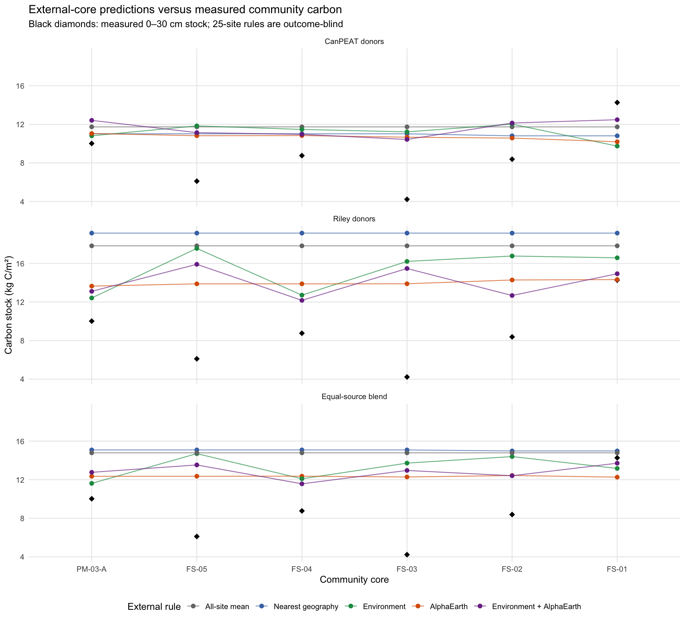
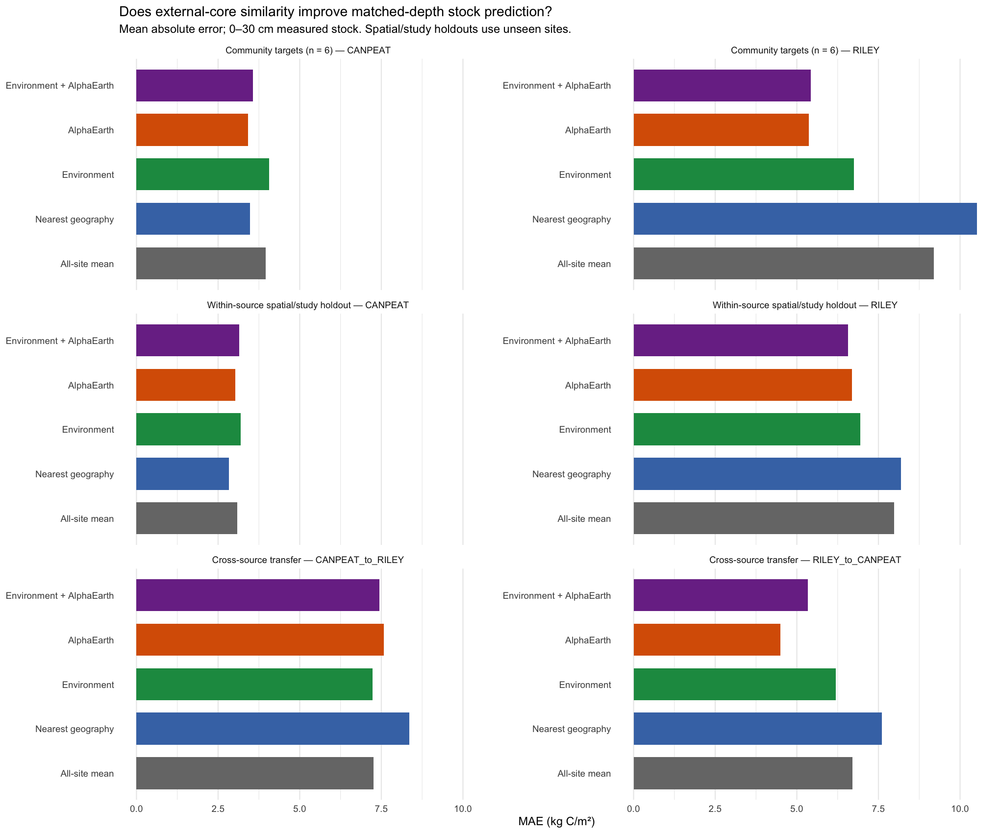

# External-core similarity transfer: measured 0–30 cm carbon

**Decision: retain Route L.** This is an additional diagnostic of whether Riley and CanPEAT can supply relevant donors to the six complete community profiles. It does not replace the existing local map or validate variable-depth organic carbon.

## Comparable data and protocol

- 855 unique CanPEAT sites and 141 unique Riley sites remain after complete measured 0–30 cm stock and common-covariate checks (1504 original profiles). Repeated profiles at one location are averaged before selection.
- Six complete community 0–30 cm stocks are the local targets. PM-01 and PM-02 are partial-depth profiles and are not silently compared to a full 0–30 cm target.
- Environmental, AlphaEarth and their equal-rank combination select the 25 most similar external sites. The all-site source mean and 25 nearest geographic sites are controls. A 50-site sensitivity is in the CSV outputs.
- Selection settings are fixed without community outcomes. Within-source external checks use locked spatial/study folds; the cross-source test holds an entire database out. The equal-source community blend weights CanPEAT and Riley equally rather than by their different site counts.

## Community-core prediction errors

Mean absolute error in kg C/m² (lower is better); all rules target exactly the same six measured profiles:

| Donor source | All-site mean | Geographic 25 | Environment 25 | AlphaEarth 25 | Combined 25 |
|:--|--:|--:|--:|--:|--:|
| CANPEAT | 3.95 | 3.48 | 4.07 | 3.42 | 3.56 |
| RILEY | 9.20 | 10.52 | 6.75 | 5.36 | 5.42 |
| EQUAL_SOURCE_BLEND | 6.16 | 6.42 | 5.02 | 4.38 | 4.38 |

- CanPEAT is much better calibrated to these community stocks at baseline: its all-site mean is 11.74 versus Riley 17.82 kg C/m². The community mean is 8.62.
- AlphaEarth helps Riley considerably relative to Riley's own baseline and nearest geography, but its remaining positive bias is substantial. Its apparent CanPEAT gain over nearest geography is tiny across six cores; neither difference is a reliable model-selection signal.
- The equal-source blend is a sensitivity comparison, not an endorsed pooling rule. Its AlphaEarth MAE remains above the previously tested equal-weight community residual correction (2.87 kg C/m²), although the two procedures answer different transfer questions.
- Widening AlphaEarth selection from 25 to 50 external sites gives community MAE 3.68 for CanPEAT, 5.44 for Riley, and 4.51 kg C/m² for the equal-source blend. This is a sensitivity check, not a tuned choice.

Individual core predictions from the 25 most AlphaEarth-similar sites (kg C/m²):

| Community core | Measured | CanPEAT | Riley | Equal-source blend |
|:--|--:|--:|--:|--:|
| PM-03-A | 10.02 | 11.05 | 13.65 | 12.35 |
| FS-05 | 6.11 | 10.82 | 13.88 | 12.35 |
| FS-04 | 8.76 | 10.84 | 13.88 | 12.36 |
| FS-03 | 4.22 | 10.67 | 13.89 | 12.28 |
| FS-02 | 8.38 | 10.58 | 14.28 | 12.43 |
| FS-01 | 14.26 | 10.19 | 14.33 | 12.26 |

## External-site holdout checks

Matched 0–30 cm MAE in kg C/m²:

| Target / donor test | All-site mean | Geographic 25 | Environment 25 | AlphaEarth 25 | Combined 25 |
|:--|--:|--:|--:|--:|--:|
| CANPEAT | 3.09 | 2.84 | 3.19 | 3.03 | 3.15 |
| RILEY | 7.98 | 8.19 | 6.94 | 6.69 | 6.57 |
| CANPEAT_to_RILEY | 7.26 | 8.36 | 7.23 | 7.58 | 7.44 |
| RILEY_to_CANPEAT | 6.71 | 7.61 | 6.19 | 4.50 | 5.34 |

- Within CanPEAT, nearby geography is strongest; AlphaEarth is slightly better than the all-site mean but worse than geography. Within Riley, combined similarity is strongest. There is no universal winner.
- Cross-source predictions retain systematic source bias: CanPEAT-to-Riley underpredicts and Riley-to-CanPEAT overpredicts. Similarity does not remove the need for local calibration.

## Are covariate-similar donors actually carbon-similar?

- For the six community targets, AlphaEarth similarity versus *smaller absolute donor-stock difference* has median Spearman association -0.026 for CanPEAT (positive at 2/6 cores) and 0.404 for Riley (6/6 cores). This is descriptive: each target is compared with many non-independent donors.
- AlphaEarth-selected 25 sites are still typically 436 km (CanPEAT) and 798 km (Riley) from community targets. Embedding similarity is not proof of local ecological equivalence.
- The top-10 and top-25 donor tables expose study, ecosystem, coordinates, similarity scores, geographic distance, and actual stock difference for manual ecological review.

## Interpretation and next decision

This check supports using external sites as a *regional reference pool*, with CanPEAT and Riley inspected separately and community cores providing the local calibration. It does not support replacing Route L with a fixed-depth nearest-neighbour map or assigning external neighbours independent Bayesian precision. The small community sample, source shift, potential ecosystem mismatch, and long donor distances make the apparent AlphaEarth improvement exploratory.

Before a map challenger is considered, carry forward depth-matched profile modelling and community leave-one-site-out checks; require gains for organic contact depth and organic carbon, not just fixed 0–30 cm stock. Audit the missing central QA tile and full predictor coverage. Keep current Route L maps and uncertainty proxy unchanged in the meantime.

See [protocol](METHODS.md), [site-level summary](prediction_summary.csv), [six-core comparison](community_core_comparison.csv), [all per-community predictions](source_specific_predictions.csv), and [top external donors](community_top25_external_sites.csv).
